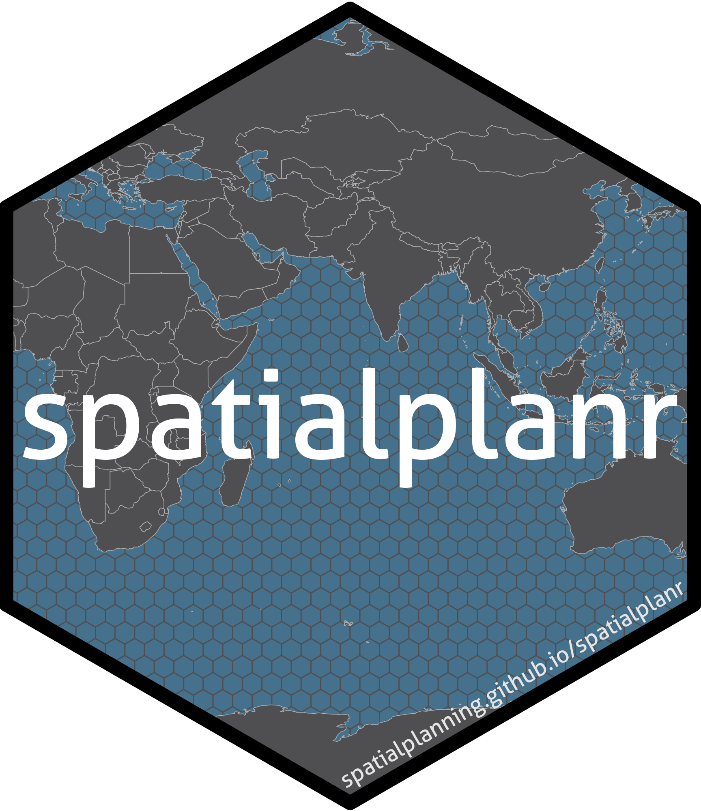

---
project:
  type: website
  output-dir: .

format:
  html:
    theme: yeti
    toc: false
    link-external-newwindow: true
    embed-resources: true
    page-layout: full

editor: visual

lightbox: true
site: spatialplanr
---

{fig-align="center" width="30%"}

<strong><em>spatialplanr</em> has moved. You can now find us <a href="https://spatialplanning.github.io/spatialplanr/" target="_blank">here</a>. </strong>

 

  <strong>We are now part of the <a href="https://spatialplanning.github.io/" target="_blank">SpatialPlanning GitHub Organisation </a>. </strong>

